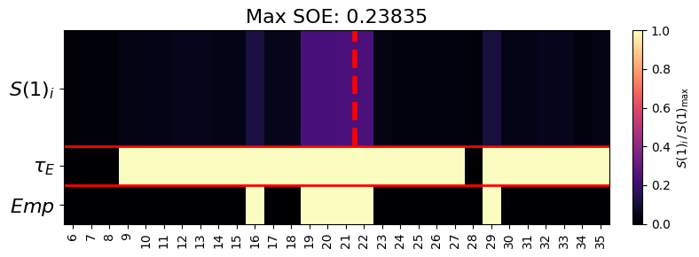
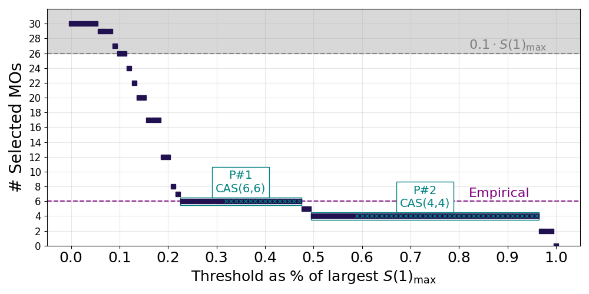
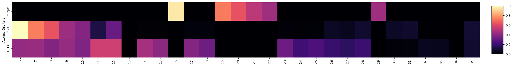
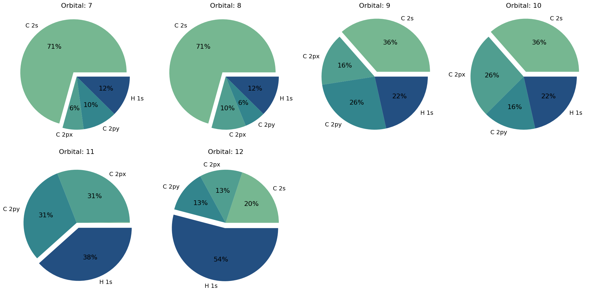

# Utilities

Helper functions for orbital export, plotting, MO composition, entropy data, and
runtime configuration.

```python
from aegiss.utils import (
    dump_qmi,
    get_orbital_spaces,
    get_subspaces_from_cas,
    plot_ao_contribution,
    plot_pie_contribution,
    print_banner,
    save_orbitals,
    soe_heatmap,
    th_plots,
)
from aegiss.utils.dump import save_orbitals_from_entropies
from aegiss.utils.mo_composition import mo_ao_contributions
```

## Orbital spaces

::: aegiss.utils.orbital_indices.get_orbital_spaces
    options:
      heading_level: 3

::: aegiss.utils.orbital_indices.get_subspaces_from_cas
    options:
      heading_level: 3

::: aegiss.utils.orbital_indices.valence_occupied_orbitals
    options:
      heading_level: 3

::: aegiss.utils.orbital_indices.resolve_nelecas
    options:
      heading_level: 3

::: aegiss.utils.orbital_indices.combine_candidate_entropies
    options:
      heading_level: 3

---

## Orbital export

::: aegiss.utils.dump.save_orbitals
    options:
      heading_level: 3

::: aegiss.utils.dump.save_orbitals_from_entropies
    options:
      heading_level: 3

---

## Entropy and mutual information

The AEGISS pipeline computes **single-orbital entropies** only: `select_aegiss` and
`run_dmrg_subprocess` do not return an orbital mutual-information (MI) matrix. The MI
plots ([`mi_plot`](#plotting) and [`entanglement_diagrams`](#plotting)) and
[`dump_qmi`](#aegiss.utils.dump.dump_qmi) therefore take a matrix computed elsewhere,
for example with block2's Python API, where
`DMRGDriver.get_orbital_interaction_matrix(ket)` returns
$I_{ij} = \tfrac{1}{2}(S_i + S_j - S_{ij})$ with a zero diagonal, or with any other
DMRG or CI code.

```python
import numpy as np

from aegiss.utils.dump import dump_qmi
from aegiss.utils.plotting import entanglement_diagrams, mi_plot

window = [16, 19, 20, 21, 22, 29]           # 0-based MO indices of the orbitals
s1 = np.array([0.31, 0.52, 0.55, 0.54, 0.51, 0.30])  # S(1) per orbital (illustrative)
minfo = np.load("benzene_mi.npy")           # (6, 6) MI matrix in the same order

soe1 = list(zip(window, s1))                # (orbital_index, S1) pairs
mi_plot(minfo, soe1, folder="plots", filename="benzene_MI")
entanglement_diagrams(soe1, minfo, folder="plots", filename="benzene_entanglement")
dump_qmi(minfo, s1, path="plots/benzene_qmi.npz")
```

What the external matrix must satisfy:

- It is a symmetric `(n, n)` array whose row and column `k` belong to the orbital
  `soe1[k][0]`, the same orbitals (same `mo_coeff`) that the entropies refer to. If the
  external calculation reorders the orbitals, for example with a Fiedler ordering, map
  the matrix back to your orbital order first.
- `entanglement_diagrams` reads only the upper triangle and normalises by the largest
  value, so the overall scale and the MI convention (with or without the factor 1/2)
  do not change the diagram.
- `mi_plot` draws the whole matrix on a 0 to max colour scale, so set the diagonal to
  zero.
- The single-orbital entropies can come from AEGISS itself: `run_dmrg_subprocess`
  returns them for the window from `get_subspaces_from_cas`, ordered occupied first,
  then virtual.

::: aegiss.utils.dump.dump_qmi
    options:
      heading_level: 3

---

## MO composition

A text/table companion to the AO-composition plots ([`plot_ao_contribution`](#plotting)
and [`plot_pie_contribution`](#plotting) below): it prints and returns the top-N atomic
orbital contributions to each MO.

::: aegiss.utils.mo_composition.mo_ao_contributions
    options:
      heading_level: 3

---

## Plotting

The examples below are produced by
[`docs/scripts/generate_doc_plots.py`](https://github.com/Algorithmiq/AEGISS/blob/main/docs/scripts/generate_doc_plots.py)
from a real benzene calculation (RHF/cc-pVDZ, a DMRG in the frontier CAS(30,30),
and an AO projection onto the `minao` reference). Re-run that script to refresh them.

::: aegiss.utils.plotting.soe_heatmap
    options:
      heading_level: 3

**Example** — single-orbital entropies $S(1)_i$ across the benzene frontier CAS(30,30).
The top row shows each orbital's entropy; the lower rows mark which survive the threshold
$\tau_E$ and which are left empty. The entanglement concentrates on the π-type frontier
orbitals (around 19–22), with most of the 30 CAS orbitals nearly inactive.



::: aegiss.utils.plotting.th_plots
    options:
      heading_level: 3

**Example** — the number of retained orbitals as the entropy threshold is swept from
0 to $S(1)_{\max}$. Two plateaus emerge — a broad CAS(6,6) at intermediate thresholds
and a stable CAS(4,4) at higher ones — the latter being the benzene π active space.



::: aegiss.utils.plotting.plot_ao_contribution
    options:
      heading_level: 3

**Example** — projection weight of each frontier MO onto three AO manifolds
(`C 2pz`, `C 2s`, `H 1s`). The π orbitals (19–22) light up in the `C 2pz` row, while
the σ framework spreads over `C 2s`/`H 1s`.



::: aegiss.utils.plotting.plot_pie_contribution
    options:
      heading_level: 3

**Example** — per-orbital composition of the benzene valence σ orbitals, showing how
each mixes `C 2s`, `C 2px`, `C 2py` and `H 1s` character.



::: aegiss.utils.plotting.mi_plot
    options:
      heading_level: 3

::: aegiss.utils.plotting.entanglement_diagrams
    options:
      heading_level: 3

---

## Runtime configuration

Helpers that read runtime settings from environment variables, configure logging,
and print the startup banner.

::: aegiss.utils.env.mem
    options:
      heading_level: 3

::: aegiss.utils.env.omp_num_threads
    options:
      heading_level: 3

::: aegiss.utils.env.scratch_dir
    options:
      heading_level: 3

::: aegiss.utils.env.pyscf_max_memory
    options:
      heading_level: 3

::: aegiss.utils.logging.configure_logging
    options:
      heading_level: 3

::: aegiss.utils.banner.print_banner
    options:
      heading_level: 3

---

## MolTagger

See the [MolTagger](../moltagger.md) page for the full reference and usage guide.
