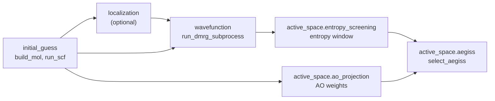

# Architecture

AEGISS narrows a candidate orbital space with two independent criteria and keeps the
orbitals that pass both: the single-orbital entanglement entropy from a DMRG run, and
the weight of each molecular orbital on a user-chosen set of atomic orbitals.

## Package layout

| Module | Role |
| --- | --- |
| `aegiss.initial_guess` | molecule construction and SCF (RHF/UHF/RKS/UKS, solvent, relativistic) |
| `aegiss.localization` | localized orbitals (Boys, Edmiston-Ruedenberg, Pipek-Mezey, IBO, IAO), natural and frozen natural orbitals, all behind the `localize` dispatcher |
| `aegiss.wavefunction` | DMRG through `block2main` as a subprocess, and correlated wavefunctions (MP2, CISD, CCSD) |
| `aegiss.active_space` | entropy screening, AO projection, and `select_aegiss`, which combines them |
| `aegiss.config_dataclasses` | the `DMRGConfig`, `EntropyConfig`, `ProjectionConfig` and `OutputConfig` inputs, validated on construction |
| `aegiss.utils` | I/O, plotting, environment variables, logging, orbital-index display, MolTagger |

## Conventions that cross modules

- **Orbital indices are 0-based internally.** User-facing indices honour
  `AEGISS_ORB_BASE` (see [Orbital Index Base](orbital_indexing.md)); convert at the
  boundary with `aegiss.utils.orb_display`, never in the middle of an algorithm.
- **Unrestricted references run per spin channel.** Functions that accept a UHF
  mean-field return `{"alpha": ..., "beta": ...}` instead of a single array, and the two
  channels are never reconciled into one spatial index set (see
  [UHF References](uhf.md)).
- **DMRG runs out of process.** `wavefunction/dmrg_subprocess.py` writes an FCIDUMP and
  a `block2main` input under `SCRATCH_DIR` and parses the entropies back, so the
  `block2` Python API is never imported.
- **Configuration is data.** New options go into the matching dataclass, with
  validation in its `__post_init__`, rather than into new keyword arguments of
  `select_aegiss`.

## Extending

- A new localization method goes in `aegiss.localization` and is dispatched from
  `localize`; add it to the localization tables in the tutorials and in
  `docs/api/localization.md`.
- A new screening criterion follows the shape of `entropy_screening` and
  `ao_projection`: a pure function from orbitals to selected indices, plus a config
  dataclass, combined in `select_aegiss`.
- A new correlated method for natural orbitals goes in `wavefunction/methods.py` and
  its dispatcher.
