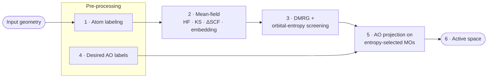

# AEGISS

**Atomic Orbital and Entropy based Guided Inference for Space Selection**

AEGISS is a semi-automated protocol for defining active spaces for multireference
quantum chemistry (CASSCF, CASPT2, NEVPT2) and hybrid classical–quantum calculations.
It unifies the two established families of active-space selection: a correlated
**DMRG** calculation supplies per-orbital entanglement information (in the spirit of
AutoCAS), while an **AVAS-like projection** onto user-specified atomic orbitals extracts
the chemically meaningful subset. An orbital enters the final space only when it is both
strongly correlated *and* chemically aligned with the process of interest.

## The AEGISS procedure



Following Section 3 of the AEGISS paper, the workflow proceeds in six steps.

### 1 · Atom labeling — *pre-processing, optional*

The molecule is partitioned into clusters $C_i$; each atom $X$ in cluster $i$ is labeled
$X_i$, and the union of clusters defines the full set $\{R\}$. A coarse labeling gives a
general description, a finer one targets specific atomic orbitals. Skip this step if you
have no prior knowledge of the system. See also [MolTagger](moltagger.md) for interactive
tagging.

### 2 · Mean-field calculation

An HF (or Kohn–Sham DFT) SCF yields the MO coefficient matrix $[C]_{\mu p}$; an embedding
framework (e.g. solvation) can be included here. If the process of interest is localized,
an active region $A$ is identified and only its orbitals $\{\psi^A_p\}$ are retained — the
environment is left untouched and every subsequent step operates within $A$.

### 3 · Single-orbital entropy screening

A correlated wavefunction (approximate DMRG) is computed inside $A$ and used to build each
orbital's one-orbital reduced density matrix $\rho^p$. The single-orbital entropy

$$
S(1)_p = -\sum_{\alpha=1}^{4} \omega_{\alpha,p} \ln \omega_{\alpha,p}
$$

(with $\{\omega_{\alpha,p}\}$ the eigenvalues of $\rho^p$) ranks orbitals by entanglement.
All orbitals with $S(1)_p > \tau_E = S(1)_{\max}/10$ are retained. In practice, choose the
active region $N_A$ as a Fermi-level window a few times larger than the expected final CAS
and check that the highly entropic orbitals lie well inside it.

The window is taken by orbital index (`ncas` orbitals around the occupied/virtual
boundary), which follows the Fermi level only for **canonical** orbitals, ordered by
orbital energy. Localized orbitals (Boys, Pipek–Mezey, Edmiston–Ruedenberg, IBOs) are
obtained by rotating the occupied and virtual blocks separately: the occupied/virtual
partition is preserved, but localized orbitals have no orbital energies, so their order
within each block is arbitrary and an index window over them is no longer a frontier
window. Natural orbitals are ordered by occupation number instead, a different but
still meaningful criterion. Localization can be combined with AEGISS, but then check
explicitly that the window contains the orbitals of interest.

### 4 · Atomic-orbital selection

Chemically relevant AOs are identified from prior chemical knowledge: for each cluster
label $X_i$ an AO type is specified (e.g. `"C 2pz"`, `"Fe 3d"`), forming combined labels
that are grouped into one or more AO sets $D \in \mathcal{D}$.

### 5 · Atomic-orbital projection

Following AVAS, an auxiliary minimal atomic-orbital basis (MinAO) is built and, for each
group $D$, overlapped against the entropy-selected active-region MOs. Orbitals are then
kept either by a contribution threshold $\epsilon_D$ or by top-N ranking on the resulting
projection weights $w_p^D$.

### 6 · Active space

The per-group selections are merged into the final active space

$$
\{\psi_r\} = \bigcup_{D \in \mathcal{D}} \{\psi_r^D\},
$$

refined further if required. The result is applicable to both classical CAS-based methods
and hybrid classical–quantum calculations.

!!! note
    The [tutorials](tutorials/index.md) walk through each step with runnable notebooks and
    give the full mathematical treatment.

## Quick start

```{.python notest}
from aegiss.initial_guess import build_mol, run_scf
from aegiss.active_space import select_aegiss
from aegiss.config_dataclasses import DMRGConfig, EntropyConfig, ProjectionConfig, OutputConfig

mol = build_mol("molecule.xyz", basis="ccpvdz")
mf  = run_scf(mol, method="RHF")

active_indices = select_aegiss(
    mol, mf,
    dmrg_config=DMRGConfig(ncas=20, nelecas=20, symm_type="SZ"),
    entropy_config=EntropyConfig(fraction=0.1, fraction_type="r", ranking="global"),
    projection_config=ProjectionConfig(ao_labels=["C 2pz"], contribution=0.5),
    output_config=OutputConfig(saving_folder="./orbs/"),
)
```

## Where to go next

| | |
|---|---|
| [Installation](installation.md) | Dependencies, environment variables, logging |
| [Tutorials](tutorials/index.md) | Step-by-step notebooks from SCF to the full pipeline |
| [MolTagger](moltagger.md) | Interactive 3D viewer for atom tagging and AO label generation |
| [API Reference](api/index.md) | Complete function and class documentation |

## License

AEGISS is released under the
[Apache License 2.0](https://github.com/Algorithmiq/AEGISS/blob/main/LICENSE).
Copyright 2026 Algorithmiq Ltd.
