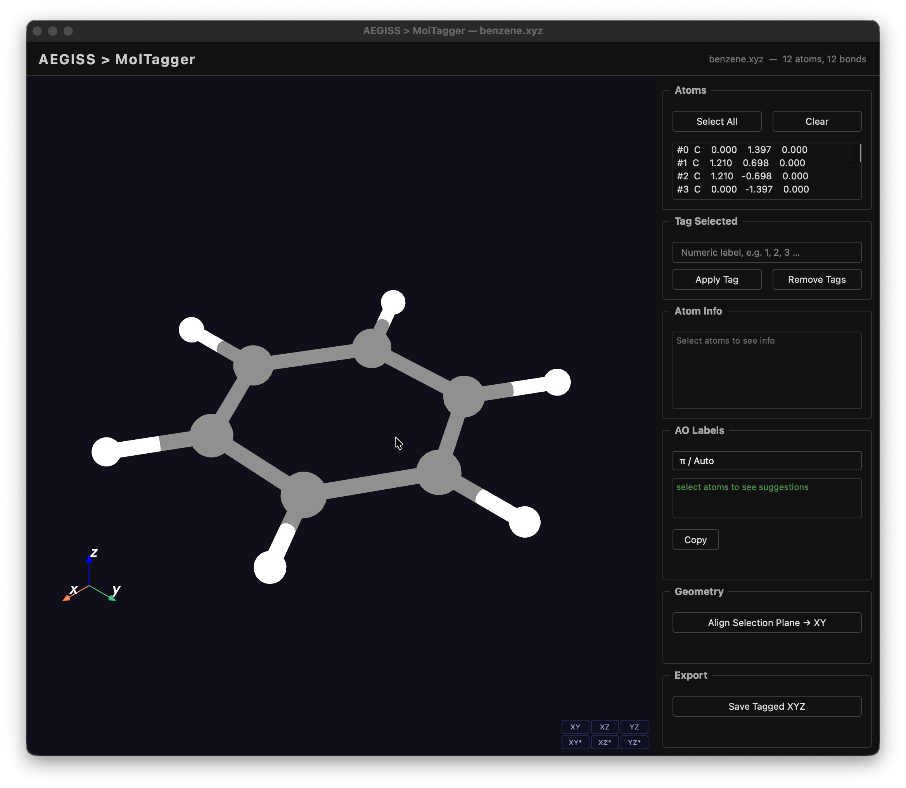
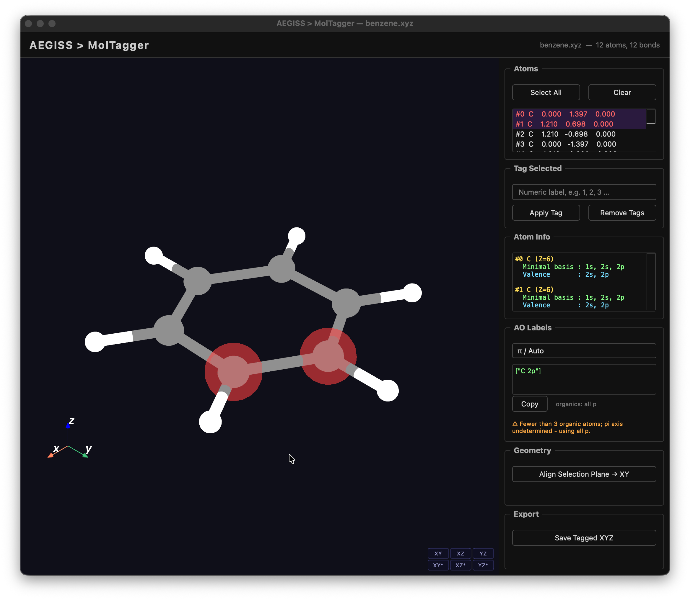
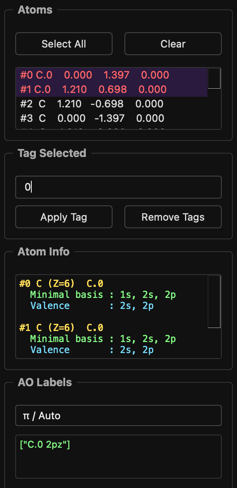
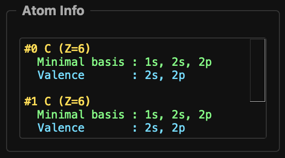
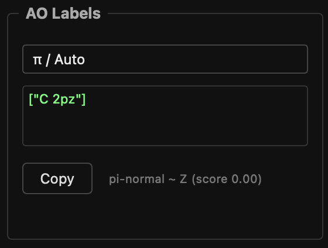
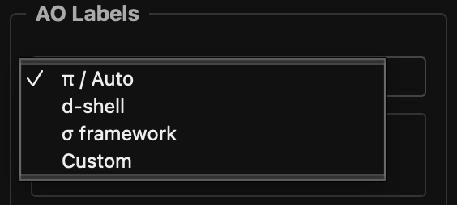
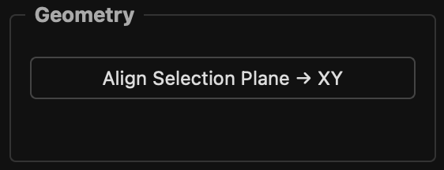
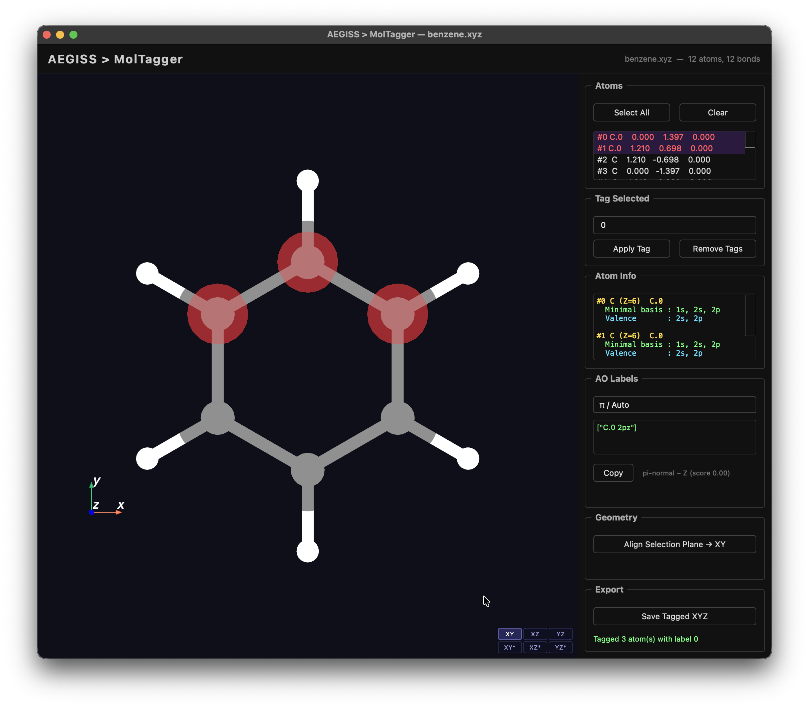

# MolTagger

Interactive 3D molecular viewer for selecting atoms and generating PySCF-compatible
`ao_labels` strings ready to paste into `ProjectionConfig`.


## Requirements

MolTagger requires the `viz` optional extra:

```bash
uv sync --extra viz
```

This pulls in `ase`, `pyvista`, `pyvistaqt`, `qtpy`, and `PySide6`.

## Quick start

```python
from aegiss.utils.mol_tagger import MolTagger

tagger = MolTagger("my_molecule.xyz")
tagger.show()                 # opens the viewer; blocks until the window is closed
print(tagger.export_tags())   # {atom_index: "Element.N", ...}
```

---

## UI overview

```
┌─────────────────────────────────────────────┬──────────────┐
│                                             │  Atoms       │
│                                             │  Tag Selected│
│           3D viewport                       │  Atom Info   │
│        (PyVistaQt / VTK)                    │  AO Labels   │
│                                             │  Export      │
└─────────────────────────────────────────────┴──────────────┘
```

The 3D viewport supports standard mouse navigation: rotate (left-drag), zoom (scroll), pan (middle-drag).
Additional camera controls — fixed orientations and auto-alignment — are described in the [Camera / Navigation](#camera-navigation) section.

### Selecting atoms

| Action | Effect |
|---|---|
| **Right-click** atom in 3D view | Toggle selection (click, not drag) |
| **Click row** in Atoms panel | Toggle selection from the list |
| **Select All / Clear** buttons | Bulk select / deselect |

Selected atoms are highlighted with a translucent red halo in the 3D view and
highlighted in the atom list simultaneously. Both views stay in sync.



### Tagging atoms
1. Select one or more atoms.
2. Type a whole-number label in the **Tag Selected** text box (e.g. `0`).
3. Press **Apply Tag** or `Return`.

{ width="40%" }

Each tagged atom is stored as `Element.N` (e.g. `C.1`, `Ru.2`). Tags appear next to the
atom coordinates in the Atoms list. **Remove Tags** clears tags from the current selection.

### Atom Info panel

Shows the minimal-basis shell structure for each selected atom:

{ width="60%" }
---

## AO Labels panel


Automatically suggests PySCF-compatible `ao_labels` strings based on the selected atoms
and the chosen **character mode**. The output is ready to copy directly into
`ProjectionConfig`. For example:

```python
["Ru 4d", "N 2pz", "C 2pz"]
```

{ width="60%" }

Press **Copy** to send the string to the system clipboard.

### Character modes

{ width="60%" }

| Mode | Intended use | Logic |
|---|---|---|
| **π / Auto** | π systems, MLCT/LMCT states | Metals → d/f shell. Organic atoms → `np{axis}` where `{axis}` is the plane-normal detected by SVD planarity analysis. Falls back to all `np` if non-planar. |
| **d-shell** | Pure metal-centred active spaces | Returns only d/f-shell labels for transition metals. Warns if ligand atoms are also selected. |
| **σ framework** | Sigma bonding / lone pair character | Organic atoms → `ns` + the two in-plane `np` components (complement of the π axis). |
| **Custom** | Manual entry | Unlocks the text box for free-form input. |

### Planarity detection

The normal to the molecular plane is found by SVD of the centred position matrix.
The planarity score is `s₂ / s₁` from the singular values.

| Score | Verdict | Labels emitted |
|---|---|---|
| < 0.25 | Planar | `C 2pz` (or `px`/`py` as appropriate) |
| ≥ 0.25 | Non-planar | All `C 2p` (warning shown in orange) |

#### Auto-alignment

The **Auto-align** button uses the SVD-detected plane normal to orient the camera perpendicular to
the molecular plane of the selected atoms, so the ring (or ligand framework) appears face-on.

{ width="60%" }

Auto-alignment is only meaningful for planar selections (score < 0.25). For non-planar selections
the button is still available but the resulting view is along the dominant singular vector, which
may not be chemically intuitive.

### Transition metal classification

| Range | Shell |
|---|---|
| Sc–Zn (Z 21–30) | 3d |
| Y–Cd (Z 39–48) | 4d |
| La (Z 57), Hf–Hg (Z 72–80) | 5d |
| Ce–Lu (Z 58–71) | 4f **+ 5d** |
| Ac (Z 89), Rf–Cn (Z 104–112) | 6d |
| Th–Lr (Z 90–103) | 5f **+ 6d** |

Lanthanides and actinides produce **two labels** because CASSCF active spaces for
f-element complexes routinely require both the f and d shells.

### Examples

Select **Ru only** → `["Ru 4d"]`

Select **Ru + bpy C/N atoms** in π / Auto mode:
```python
["Ru 4d", "C 2pz", "N 2pz"]   # assuming z is the ring-plane normal
```

Select **Ce** in d-shell mode:
```python
["Ce 4f", "Ce 5d"]
```

---

## Camera / Navigation

### Mouse controls

| Action | Effect |
|---|---|
| **Left-click + drag** | Rotate |
| **Scroll wheel** | Zoom in / out |
| **Middle-click + drag** | Pan |
| **Right-click** | Select atom (does not move camera) |

### Fixed orientations

Four preset buttons snap the camera to a standard plane-aligned view, keeping the current molecule
centre:

{ width="50%" }

| Button | Camera looks along | Plane shown |
|---|---|---|
| **XY** | +Z axis | XY plane (top view) |
| **XZ** | +Y axis | XZ plane (front view) |
| **YZ** | +X axis | YZ plane (side view) |
| **\*** | — | Reset to default isometric view |

---

## Tagged XYZ format

**Save Tagged XYZ** writes a standard XYZ file where tagged atoms use the `Element.N`
label instead of the bare element symbol:

```
12

C.1     -1.212345   0.000000   0.000000
C.1      1.212345   0.000000   0.000000
N.2     -2.345678   1.000000   0.000000
Ru.3     0.000000   0.000000   0.000000
H        1.500000   1.000000   0.000000
```

The file can be reloaded into MolTagger; tags are automatically recovered from the
`Element.N` labels.
