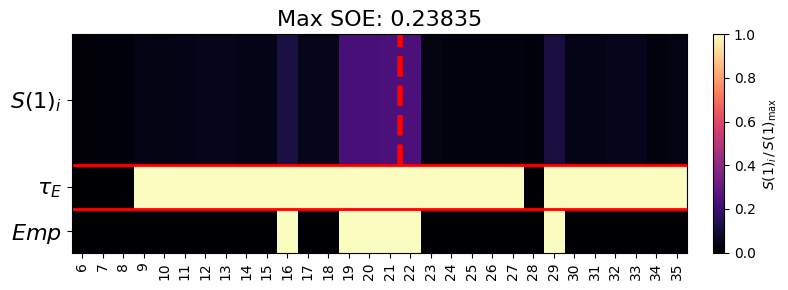
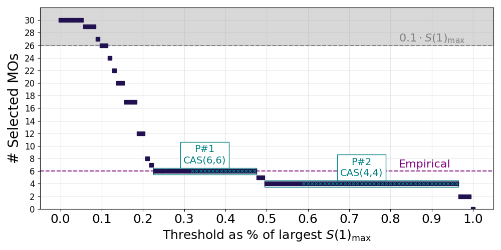
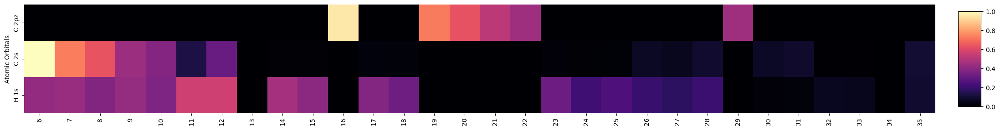
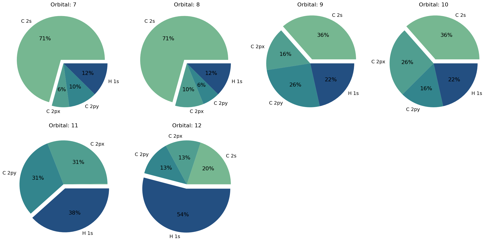

# Tutorials

The tutorials walk through the full AEGISS workflow using benzene as a running example.
Each notebook is self-contained and builds on the previous one.

| Notebook | Topic |
|---|---|
| [01 — SCF & Localization](01_scf_and_localization.ipynb) | Building the molecule, running HF/DFT, solvation models (PCM, DD-COSMO), scalar relativistic corrections (X2C), orbital localization (Boys, PM, ER, NOs, FNOs) |
| [02 — DMRG & Entropy](02_dmrg.ipynb) | `DMRGConfig`, running DMRG, inspecting single-orbital entropies, entropy screening |
| [03 — AO Projection](03_ao_projection.ipynb) | `ProjectionConfig`, AO-projection selection, thresholds and top-N ranking |
| [04 — Full Pipeline](04_aegiss.ipynb) | End-to-end AEGISS pipeline with all four config objects |

---

## Algorithm overview

### Inputs

- Molecular structure: $\{\mathcal{R}\}$
- Mean-field method and basis set
- Correlated wavefunction method: $\mathcal{W}$ (DMRG via block2)
- AO groups: $\mathcal{D}$ — PySCF `ao_labels` strings, e.g. `"Fe 3d"`, `"C 2pz"`
- Entropy threshold: $\tau_E$ (default: $0.1 \times S(1)_{\max}$, configurable)
- AO cutoff: $\epsilon_D$ or rank threshold $n_D$

### Output

Final active orbital space: $\{\psi_r\}$

---

## Step 1 — Atom labeling and AO group definition

Partition the molecule into chemically meaningful clusters $\mathcal{C}_i$ (e.g. metal
centre, ligand π system, σ framework). For each cluster define an AO group
$D_i \in \mathcal{D}$ as a set of PySCF `ao_labels` strings.

!!! tip "MolTagger"
    `aegiss.utils.mol_tagger.MolTagger` provides an interactive 3D viewer for selecting
    atoms and auto-generating `ao_labels` strings ready to paste into `ProjectionConfig`.

---

## Step 2 — Mean-field calculation

Perform [HF](https://pyscf.org/user/scf.html) or [KS-DFT](https://pyscf.org/user/dft.html)
to obtain the MO coefficient matrix $[\mathbf{C}]_{\mu p}$, then select orbitals belonging
to the active region $\mathbf{A}$ defined by the CAS window (`ncas`, `nelecas`).

**Optional solvation** — for molecules in solution, pass `solvent_info=(model, dielectric_constant)`
to `run_scf`. Two implicit-solvent families are supported
([PySCF solvation docs](https://pyscf.org/user/solvent.html)):

| Model | Key | Notes |
|---|---|---|
| [IEF-PCM](https://pyscf.org/user/solvent.html#pcm-model) | `"IEF-PCM"` | ISO standard; general purpose |
| [C-PCM](https://pyscf.org/user/solvent.html#pcm-model) | `"C-PCM"` | Conductor-like limit; slightly cheaper |
| [DD-COSMO](https://pyscf.org/user/solvent.html#ddcosmo) | `"DDCOSMO"` | Linear-scaling; good for large systems |

```python
mf_pcm = run_scf(mol, method="RHF", solvent_info=("IEF-PCM", 78.4))  # water
```

The solvation wrapper is fully composable with the `relativistic` parameter and
propagates into the DMRG integral step transparently via `CASCI.get_h1eff`.

---

**Optional scalar relativistic correction** — for systems containing transition metals
or heavier elements, pass `relativistic='x2c'` to `run_scf` to apply the
[exact two-component (X2C) transformation](https://pyscf.org/user/scf.html#scalar-relativistic-correction).
The relativistic one-electron Hamiltonian propagates automatically into the DMRG integral
step via `CASCI.get_h1eff`.

```python
mf = run_scf(mol, method="RHF", relativistic="x2c")
```

**Optional orbital localization** — canonical MOs can be transformed before DMRG to
improve physical interpretability of entropy screening:

| Key | Method | Criterion |
|---|---|---|
| `"boys"` | Foster–Boys | Minimum orbital spread |
| `"pm"` | Pipek–Mezey | Maximum atomic charge; preserves σ/π separation |
| `"er"` | Edmiston–Ruedenberg | Maximum self-repulsion energy |
| `"nos"` | Natural Orbitals | Diagonalise correlated 1-RDM |
| `"fnos"` | Frozen Natural Orbitals | As NOs but with a frozen core |

---

## Step 3a — Correlated wavefunction in active region

AEGISS solves the active-space problem with **DMRG**, run through the `block2main`
subprocess (`run_dmrg_subprocess`). PySCF builds the CAS integrals (a `FCIDUMP`) for
the active region $\mathbf{A}$; block2 then converges the DMRG ground state
$|\Psi\rangle$ and writes out the spin-resolved one-particle density matrix (`1pdm`)
and the diagonal number–number correlation (`1npc`) — together these provide
everything needed for the single-orbital entropies below.

### One-orbital reduced density matrix

For each orbital $p \in \mathbf{A}$, the one-orbital reduced density matrix $\rho^p$
is defined by tracing $|\Psi\rangle\langle\Psi|$ over all orbitals except $p$:

$$
\rho^p = \mathrm{Tr}_{\mathbf{A} \setminus \{p\}} \left( |\Psi\rangle\langle\Psi| \right)
$$

In the local occupation basis
$|\alpha\rangle \in \{|0\rangle,\, |\!\uparrow\rangle,\, |\!\downarrow\rangle,\, |\!\uparrow\downarrow\rangle\}$
a single orbital carries no coherences, so $\rho^p$ is **diagonal** and its four
eigenvalues are precisely the occupation probabilities $\{\omega_{\alpha,p}\}$
(with $\omega_{\alpha,p} \geq 0$ and $\sum_\alpha \omega_{\alpha,p} = 1$).

Rather than forming $\rho^p$ explicitly, AEGISS reconstructs these probabilities from
the DMRG one-particle observables: the spin occupations $\langle n_{p\uparrow}\rangle$,
$\langle n_{p\downarrow}\rangle$ (diagonal of the `1pdm`) and the double occupancy
$d_p = \langle n_{p\uparrow} n_{p\downarrow}\rangle$. The double occupancy is recovered
from the diagonal of the number–number correlation, since
$\langle n_p^2\rangle = \langle n_p\rangle + 2\,d_p$ for $n_p = n_{p\uparrow} + n_{p\downarrow}$:

$$
d_p = \tfrac{1}{2}\left(\langle n_p^2\rangle - \langle n_p\rangle\right),
\qquad
\langle n_p\rangle = \langle n_{p\uparrow}\rangle + \langle n_{p\downarrow}\rangle
$$

which fixes the four occupation probabilities as

$$
\begin{aligned}
\omega_{\uparrow\downarrow,\,p} &= d_p, &
\omega_{\uparrow,\,p}           &= \langle n_{p\uparrow}\rangle - d_p, \\[2pt]
\omega_{\downarrow,\,p}         &= \langle n_{p\downarrow}\rangle - d_p, &
\omega_{0,\,p}                  &= 1 - \langle n_p\rangle + d_p .
\end{aligned}
$$

---

## Step 3b — Entropy-based reduction

For each orbital $p$, the single-orbital entropy is the von Neumann entropy of
$\rho^p$ — equivalently, the Shannon entropy of its four occupation probabilities:

$$
S(1)_p = -\sum_{\alpha \in \{0,\,\uparrow,\,\downarrow,\,\uparrow\downarrow\}}
\omega_{\alpha,p} \, \ln \omega_{\alpha,p}
$$

where any state with $\omega_{\alpha,p} \to 0$ contributes nothing to the sum.

$S(1)_p$ quantifies the entanglement of orbital $p$ with the rest of the active space.
It is zero for orbitals that are fully occupied or fully empty (doubly occupied core or
unoccupied virtual), and maximal for orbitals in a strongly correlated superposition.

Select entropy-active orbitals:

$$
\{\psi^{\mathbf{A}}_{E}\} = \{\psi_p^{\mathbf{A}} \mid S(1)_p \geq \tau_E\}
$$

| `fraction_type` | Threshold $\tau_E$ |
|---|---|
| `'r'` (relative, default) | $\text{fraction} \times S(1)_{\max}$ |
| `'a'` (absolute) | $\text{fraction}$ directly |

The threshold is applied **independently** to occupied and virtual subspaces
(`ranking='subset'`, default) or to all CAS orbitals jointly (`ranking='global'`).

!!! tip "Diagnostics"
    The entropy spectrum is best read visually with
    [`soe_heatmap`](../api/utils.md#plotting) and [`th_plots`](../api/utils.md#plotting)
    (utilities reference). For a benzene CAS(30,30), the entanglement concentrates on the
    π-type frontier orbitals, and the threshold curve exposes two plateaus — CAS(6,6) and,
    at higher thresholds, the π-only CAS(4,4):

    

    { width="85%" }

---

## Step 4 — AO projection for each group $D \in \mathcal{D}$

For each AO group $D$ (e.g. `"Fe 3d"`, `"C 2pz"`), a weight $w_p^D$ is assigned to
every entropy-filtered orbital $\psi_p \in \{\psi^{\mathbf{A}}_E\}$ that measures how
much of that orbital lives in the target chemical subspace.

### Cross-overlap matrix $\mathbf{O}^D_E$

The projection is performed against a **secondary minimal basis** (default: `minao`) rather
than the original working basis. Let $\{\phi^D_\mu\}$ be the AOs of the minimal basis
restricted to the atoms and angular-momentum channels defined by $D$, and let
$\{\phi^E_\nu\}$ be the AOs of the original molecular basis. The cross-overlap matrix is:

$$
[\mathbf{O}^D_E]_{\mu\nu} = \langle \phi^D_\mu \mid \phi^E_\nu \rangle, \qquad \mu \in D,\ \nu \in E
$$

computed via `pyscf.gto.intor_cross("int1e_ovlp", ...)`. Using a minimal basis for $D$
removes noise from diffuse or polarisation functions that are present in the working basis
but are not chemically meaningful for the selection criterion.

### Projection and weight

The MO coefficients $[\mathbf{C}_E]_{\nu p}$ expand each orbital $\psi_p$ in the original
basis. The projection of $\psi_p$ onto the target AO subspace $D$ is:

$$
[\mathbf{O}^D_E\,\mathbf{C}_E]_{\mu p}
= \sum_{\nu \in E} [\mathbf{O}^D_E]_{\mu\nu}\,[\mathbf{C}_E]_{\nu p}
= \langle \phi^D_\mu \mid \psi_p \rangle
$$

The weight is the $\ell^1$ norm of this projection over all $\mu \in D$:

$$
w_p^D = \sum_{\mu \in D} \left|\langle \phi^D_\mu \mid \psi_p \rangle\right|
= \sum_{\mu \in D} \left|[\mathbf{O}^D_E\,\mathbf{C}_E]_{\mu p}\right|
$$

A large $w_p^D$ means orbital $\psi_p$ has strong overlap with the target AO characters;
a value near zero means it is essentially orthogonal to that subspace.

### Normalisation

| `contribution_type` | Weight used for thresholding |
|---|---|
| `'a'` (absolute) | $w_p^D$ directly |
| `'r'` (relative) | $\tilde{w}_p^D = w_p^D \,/\, \max_{p'} w_{p'}^D \in [0,1]$ |

### Selection

Two modes are available, controlled by `ProjectionConfig`:

- **Threshold** — keep all $\psi_p$ where $w_p^D \geq \epsilon_D$
- **Top-N** — keep the $n_D$ orbitals with the largest $w_p^D$, regardless of magnitude

!!! tip "Diagnostics"
    The projection weights $w_p^D$ can be inspected with
    [`plot_ao_contribution`](../api/utils.md#plotting) (a per-MO / per-AO-group heatmap)
    and the per-orbital composition with
    [`plot_pie_contribution`](../api/utils.md#plotting) (utilities reference). For benzene,
    the π orbitals concentrate on `C 2pz` while the σ framework mixes `C 2s`/`C 2px`/`H 1s`:

    

    { width="90%" }

---

## Step 5 — Active space construction

Merge selected sets across all AO groups:

$$
\{\psi_r\} = \bigcup_{D \in \mathcal{D}} \{\psi_r^D\}
$$
